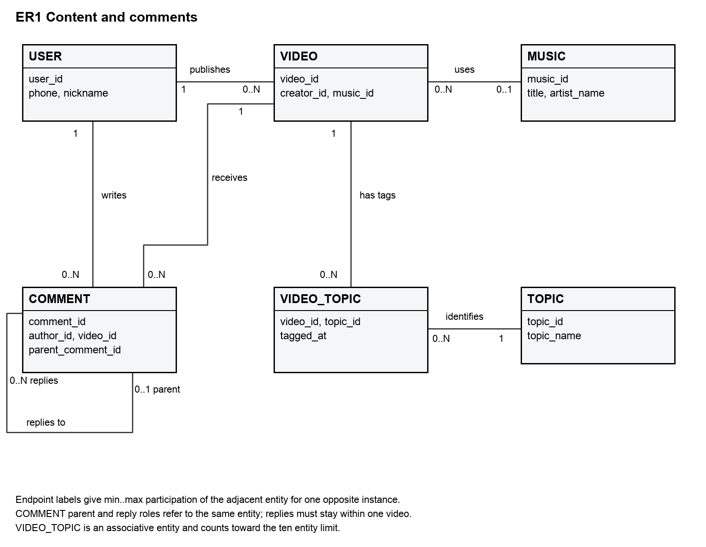
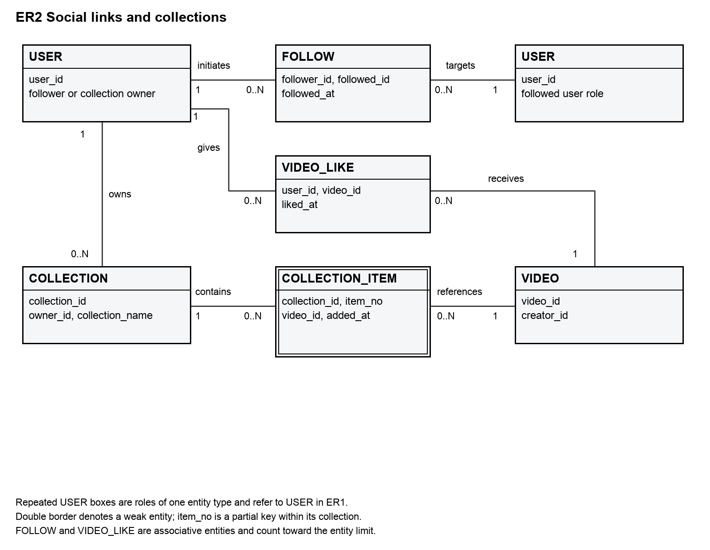
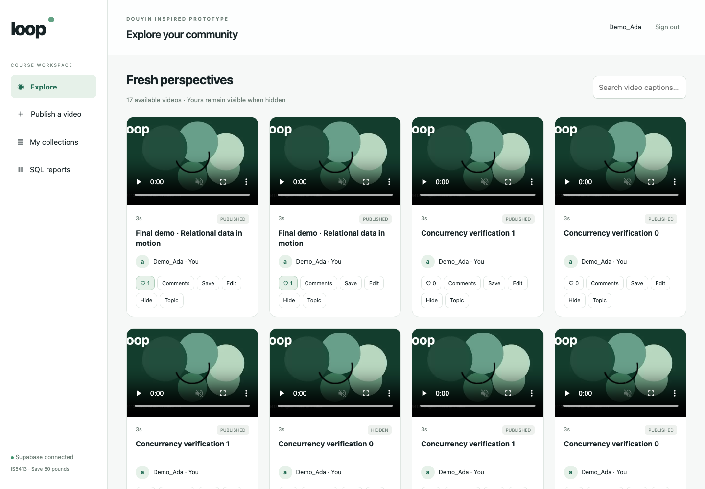
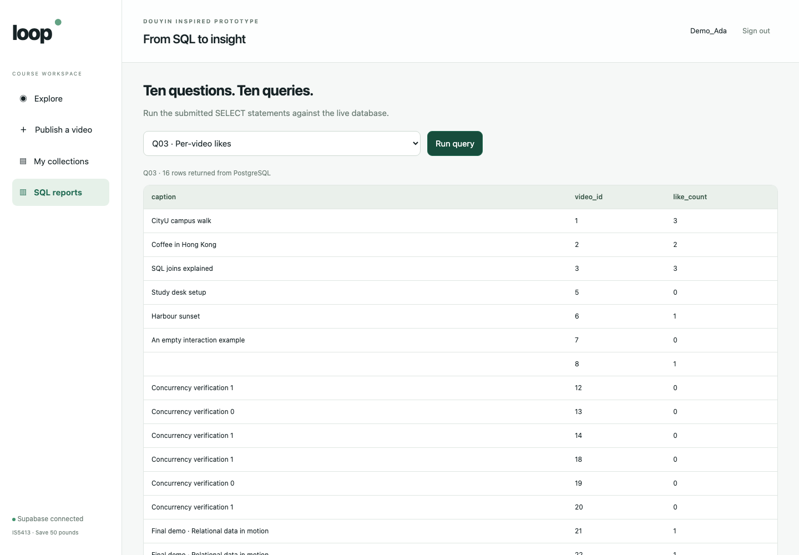

# Database Design and Implementation for a Short Video Platform

Database Design and Implementation for a Short Video Platform

IS5413 Database Management
Final Project Report 2026/27 A

Team name  Save 50 pounds

Public repository edition. Team member names and student IDs are retained only in the private course submission.

## 1 Project outcome and scope

We implemented Loop, a simplified Douyin-inspired database application. The system supports video publication, optional music, topic tagging, comments and replies, likes, directed follows and personal collections. A local browser interface connects to a Python service and an actual Supabase-hosted PostgreSQL 17.11 database. The application is an independent course design, not a reconstruction of Douyin's internal schema.

The final model contains exactly 10 entity types and 10 business relations with 43 attributes. It includes associative entities, a weak collection item and a recursive comment relationship. The logical schema is in 3NF under its declared dependencies. Physical implementation adds keys, checks, indexes, guarded database functions and triggers without adding business entities.

We initially loaded 69 synthetic records. Real acceptance tests and browser demonstrations added retained test records; the final catalog snapshot contains 100 rows. Thirty-one structural checks, 21 authenticated business and concurrency tests, four immutability probes and 14 browser acceptance checks passed. The ten required query tasks were executed against the live database; selected returned columns are presented in Sections 9 to 13.

### Scope boundary

Recommendation algorithms, watch history, live streaming, commerce, messaging, advertising, payments, transcoding and copyright management are excluded. An original generated WebM demonstrates playback. Media files remain outside relational tables, and synthetic example.invalid seed URLs do not represent accessible third-party content.

Report evidence was captured on 12 November 2026. Database creation, implementation and verification are complete for this prototype; this document does not claim a production deployment, a load test or a completed classroom presentation.


---

## 2 Conceptual design for content

A user may be both viewer and creator. Each video has one creator and zero or one music record. Video-topic pairs are unique. Every comment has one author and one video; replies point to an existing comment on the same video.



Figure 1 Content and comments. Endpoint labels give the number of adjacent entity instances for one opposite instance. VIDEO_TOPIC explicitly resolves the M:N video-topic relationship and counts as one of the ten entities. COMMENT has an independent primary identifier; its optional recursive parent does not create another entity type.

The parent must already exist, self-parenting is rejected and ancestry is immutable after insertion. Starting from the acyclic seed data, these conditions preserve an acyclic reply graph. The system stores video_id on every comment so video retrieval does not require walking to a root comment.


---

## 3 Conceptual design for social interactions



Figure 2 Social and collection view. Repeated USER boxes indicate follower and followed roles of the same entity. A directed follow pair is unique and self-following is forbidden. Likes represent the current user-video association; unlike and re-like create a new association time.

COLLECTION_ITEM is a weak entity identified by its collection and item_no partial key. Each collection has one owner. Collection names are unique within an owner, and each video occurs at most once within a collection. The same video may be in several collections. Item numbers are stable identifiers, not a continuously renumbered display order.

The combined inventory is USER, VIDEO, MUSIC, TOPIC, COMMENT, VIDEO_TOPIC, VIDEO_LIKE, FOLLOW, COLLECTION and COLLECTION_ITEM. Weak and associative entities are included in the count of ten. Empty accounts and collections are valid. Hiding a video retains its historical interactions but prevents new ones.


---

## 4 Relational schema and mapping

PK denotes the selected primary key and AK another candidate key. All attributes are NOT NULL except VIDEO.music_id and COMMENT.parent_comment_id. Names use quoted uppercase table identifiers in the private douyin schema.

### USER

USER(user_id, phone, nickname, account_status, registered_at)
PK(user_id); AK(phone)

### MUSIC

MUSIC(music_id, title, artist_name, audio_url)
PK(music_id)

### TOPIC

TOPIC(topic_id, topic_name)
PK(topic_id); AK(topic_name)

### VIDEO

VIDEO(video_id, creator_id, music_id, caption, media_url, duration_seconds, visibility_status, published_at)
PK(video_id); creator_id → USER.user_id; music_id → MUSIC.music_id

### COMMENT

COMMENT(comment_id, video_id, author_id, parent_comment_id, body_text, comment_status, created_at)
PK(comment_id); video_id → VIDEO.video_id; author_id → USER.user_id; parent_comment_id → COMMENT.comment_id

### VIDEO_TOPIC

VIDEO_TOPIC(video_id, topic_id, tagged_at)
PK(video_id, topic_id); video_id → VIDEO.video_id; topic_id → TOPIC.topic_id

### VIDEO_LIKE

VIDEO_LIKE(user_id, video_id, liked_at)
PK(user_id, video_id); user_id → USER.user_id; video_id → VIDEO.video_id

### FOLLOW

FOLLOW(follower_id, followed_id, followed_at)
PK(follower_id, followed_id); follower_id → USER.user_id; followed_id → USER.user_id

### COLLECTION

COLLECTION(collection_id, owner_id, collection_name, created_at)
PK(collection_id); AK(owner_id, collection_name); owner_id → USER.user_id

### COLLECTION_ITEM

COLLECTION_ITEM(collection_id, item_no, video_id, added_at)
PK(collection_id, item_no); AK(collection_id, video_id); collection_id → COLLECTION.collection_id; video_id → VIDEO.video_id

Strong entities map to their own relations; associations use composite participant keys. The weak item includes its owner identifier and a partial key. Recursive parent_comment_id is a nullable self-FK. Ownership is obtained through COLLECTION rather than duplicated in items.


---

## 5 Functional dependencies and normalization

N denotes all attributes outside the selected primary key, including alternate-key attributes when present. These FD generators express the declared business rules; names, media URLs and timestamps are not assumed unique unless explicitly specified.

| Relation | FD generators | Candidate keys |
| --- | --- | --- |
| USER | user_id → N; phone → user_id | user_id; phone |
| VIDEO | video_id → N | video_id |
| MUSIC | music_id → N | music_id |
| TOPIC | topic_id → topic_name; topic_name → topic_id | topic_id; topic_name |
| COMMENT | comment_id → N | comment_id |
| VIDEO_TOPIC | (video_id, topic_id) → tagged_at | (video_id, topic_id) |
| VIDEO_LIKE | (user_id, video_id) → liked_at | (user_id, video_id) |
| FOLLOW | (follower_id, followed_id) → followed_at | (follower_id, followed_id) |
| COLLECTION | collection_id → N; (owner_id, collection_name) → collection_id | collection_id; (owner_id, collection_name) |
| COLLECTION_ ITEM | (collection_id, item_no) → N; (collection_id, video_id) → item_no | (collection_id, item_no); (collection_id, video_id) |

1NF. Each attribute contains a single value. Multiple topics, follows, likes, comments and collection entries occupy separate rows. artist_name is one display-credit string; a structured multi-artist catalogue is outside scope.

2NF. Every non-prime attribute depends on each complete candidate key. liked_at depends on the user-video pair, not the user or video alone. Neither item_no nor video_id alone identifies a collection entry; added_at depends on the whole of either candidate key.

3NF. For each non-trivial FD X → a, X is a superkey or a is prime. Every generator above has a candidate key as determinant and no additional non-key determinant is assumed. Thus these relations satisfy BCNF and therefore 3NF under this dependency set. Cross-row permissions, visibility and parent consistency are integrity rules, not extra intra-relation FDs.

A flattened video record containing creator_phone would have video_id → creator_id → creator_phone. Because a creator can publish many videos, creator_id is not a key of that flattened relation. Splitting creator details into USER is lossless because the shared creator identifier determines the USER fragment; both dependencies are preserved locally. Music and topic metadata are separated for the same update-consistency reason.

No denormalization was applied. Like counts, follower counts, topic popularity and publication counts are computed from detail rows; the small prototype does not justify stored aggregate counters or their maintenance complexity.


---

## 6 Physical design for accounts and content

Implementation uses PostgreSQL 17.11, not the initially considered MySQL dialect. Six single-column keys use generated identities. Positive-ID CHECKs compensate for the absence of UNSIGNED; signed BIGINT and INTEGER limits are documented in the data dictionary.

TIMESTAMPTZ(3) stores millisecond-resolution time points; fixtures are UTC and display follows the connection time zone. phone, topic/collection names and status values use deterministic C collation. Case-distinct names are allowed. The application applies NFC normalization and strips surrounding whitespace before user text is written.

| Attribute | PostgreSQL type | Physical rule |
| --- | --- | --- |
| USER.user_id | BIGINT | Identity PK; > 0; NOT NULL |
| USER.phone | VARCHAR(32) | NOT NULL |
| USER.nickname | VARCHAR(80) | NOT NULL |
| USER.account_status | VARCHAR(16) | NOT NULL; Default 'ACTIVE' |
| USER.registered_at | TIMESTAMPTZ(3) | NOT NULL; Default CURRENT_TIMESTAMP(3) |
| MUSIC.music_id | BIGINT | Identity PK; > 0; NOT NULL |
| MUSIC.title | VARCHAR(200) | NOT NULL |
| MUSIC.artist_name | VARCHAR(200) | NOT NULL |
| MUSIC.audio_url | VARCHAR(2048) | NOT NULL |
| TOPIC.topic_id | BIGINT | Identity PK; > 0; NOT NULL |
| TOPIC.topic_name | VARCHAR(100) | NOT NULL |
| VIDEO.video_id | BIGINT | Identity PK; > 0; NOT NULL |
| VIDEO.creator_id | BIGINT | NOT NULL; FK USER.user_id |
| VIDEO.music_id | BIGINT | Nullable; FK MUSIC.music_id |
| VIDEO.caption | VARCHAR(2000) | NOT NULL; Default '' |
| VIDEO.media_url | VARCHAR(2048) | NOT NULL |
| VIDEO.duration_seconds | DECIMAL(9,3) | NOT NULL |
| VIDEO.visibility_status | VARCHAR(16) | NOT NULL; Default 'PUBLISHED' |
| VIDEO.published_at | TIMESTAMPTZ(3) | NOT NULL; Default CURRENT_TIMESTAMP(3) |

Additional domain checks enforce ASCII, nonempty trimmed phone values, positive duration_seconds, nonempty topic names and allowed statuses. Captions may be empty. Media/audio URLs are external locations; the relational database does not store media bytes or validate remote availability.


---

## 7 Physical design for interactions and collections

| Attribute | PostgreSQL type | Physical rule |
| --- | --- | --- |
| COMMENT.comment_id | BIGINT | Identity PK; > 0; NOT NULL |
| COMMENT.video_id | BIGINT | NOT NULL; FK VIDEO.video_id |
| COMMENT.author_id | BIGINT | NOT NULL; FK USER.user_id |
| COMMENT.parent_comment_id | BIGINT | Nullable; FK COMMENT.comment_id |
| COMMENT.body_text | TEXT | NOT NULL |
| COMMENT.comment_status | VARCHAR(16) | NOT NULL; Default 'VISIBLE' |
| COMMENT.created_at | TIMESTAMPTZ(3) | NOT NULL; Default CURRENT_TIMESTAMP(3) |
| VIDEO_TOPIC.video_id | BIGINT | Composite PK; NOT NULL; FK VIDEO.video_id |
| VIDEO_TOPIC.topic_id | BIGINT | Composite PK; NOT NULL; FK TOPIC.topic_id |
| VIDEO_TOPIC.tagged_at | TIMESTAMPTZ(3) | NOT NULL; Default CURRENT_TIMESTAMP(3) |
| VIDEO_LIKE.user_id | BIGINT | Composite PK; NOT NULL; FK USER.user_id |
| VIDEO_LIKE.video_id | BIGINT | Composite PK; NOT NULL; FK VIDEO.video_id |
| VIDEO_LIKE.liked_at | TIMESTAMPTZ(3) | NOT NULL; Default CURRENT_TIMESTAMP(3) |
| FOLLOW.follower_id | BIGINT | Composite PK; NOT NULL; FK USER.user_id |
| FOLLOW.followed_id | BIGINT | Composite PK; NOT NULL; FK USER.user_id |
| FOLLOW.followed_at | TIMESTAMPTZ(3) | NOT NULL; Default CURRENT_TIMESTAMP(3) |
| COLLECTION.collection_id | BIGINT | Identity PK; > 0; NOT NULL |
| COLLECTION.owner_id | BIGINT | NOT NULL; FK USER.user_id |
| COLLECTION.collection_name | VARCHAR(100) | NOT NULL |
| COLLECTION.created_at | TIMESTAMPTZ(3) | NOT NULL; Default CURRENT_TIMESTAMP(3) |
| COLLECTION_ITEM.collection_id | BIGINT | Composite PK; NOT NULL; FK COLLECTION.collection_id |
| COLLECTION_ITEM.item_no | INTEGER | Composite PK; NOT NULL |
| COLLECTION_ITEM.video_id | BIGINT | NOT NULL; FK VIDEO.video_id |
| COLLECTION_ITEM.added_at | TIMESTAMPTZ(3) | NOT NULL; Default CURRENT_TIMESTAMP(3) |

Four alternate unique keys enforce phone, topic name, collection name per owner and video occurrence per collection. Other pair uniqueness follows composite PKs. Foreign keys are non-deferrable with default NO ACTION; no cascading deletion is configured. New interactions on hidden content are rejected by triggers, while existing rows remain referenced.

The database contains 10 PKs, 4 alternate UNIQUE constraints, 14 FKs and 16 CHECKs. Six of the CHECKs enforce positive identity values. TRIM checks target ordinary spaces; application normalization does not replace database ownership checks.


---

## 8 Transaction and authorization implementation

The browser connects only to a local Python HTTP service bound to 127.0.0.1. Login is checked by PostgreSQL using one of five provisioned LOGIN roles. The service maintains an expiring HttpOnly SameSite session and a CSRF token; each database call uses the authenticated role, TLS CA verification and hostname verification. Passwords are held in local private configuration and server memory, never in frontend source or the submitted archive.

Application data stay in a private douyin schema. Demo roles receive USAGE and EXECUTE on a small application function, not direct table access, schema creation, role creation or administrator membership. The privileged function fixes search_path, qualifies business tables and derives the actor from SESSION_USER. It checks the role format and ACTIVE account before dispatching a fixed action whitelist. Supplied actor_id, creator_id, owner_id or author_id fields are rejected.

```sql
actor := substring(session_user from '([1-5])$')::bigint;
SELECT owner_id INTO owner
FROM douyin."COLLECTION"
WHERE collection_id = cid FOR UPDATE;
IF owner IS DISTINCT FROM actor THEN
  RAISE EXCEPTION 'Only the owner may modify this collection'
    USING ERRCODE = '42501';
END IF;
SELECT coalesce(max(item_no), 0) + 1 INTO n
FROM douyin."COLLECTION_ITEM" WHERE collection_id = cid;
```

Collection insertion locks the parent collection before choosing the next local number. Concurrent requests for different videos serialize and obtain distinct numbers. The unique video-per-collection key handles repeated saves, which return the existing number. Deleting an item does not renumber the remaining items; trailing numbers can be reused.

```sql
SELECT visibility_status INTO state
FROM douyin."VIDEO" WHERE video_id = NEW.video_id FOR SHARE;
IF state <> 'PUBLISHED' THEN
  RAISE EXCEPTION 'Hidden videos cannot receive new interactions'
    USING ERRCODE = '23514';
END IF;
```

Like, comment and collection-item triggers hold FOR SHARE on the target video. Hiding updates that same video and requires a conflicting row lock: a completed interaction may precede hiding, but later new interactions fail. Comment triggers require an existing parent on the same video and reject self-parenting. Comment identity, author, video and parent, plus video creator and collection owner, are immutable. Only checked creator/owner operations are exposed.

RLS remains default-deny for direct/API table access. SECURITY DEFINER is a deliberate narrow function gateway, not a claim that RLS policies implement ownership. The operator role alone may execute the ten fixed report queries; arbitrary SQL is never accepted by the HTTP interface. Database owners and provisioners remain trusted administrators.


---

## 9 SQL tasks 1 and 2

Actual live execution results captured 2026-11-12 06:04:38 UTC. Selected output columns and at most six rows are shown; full SQL and returned rows are included in 06_final_queries.json. Synthetic demonstration writes explain differences from the original 69-row fixture.

### Q01 Creator videos

```sql
SELECT v.video_id, v.caption, v.duration_seconds, v.published_at,
       u.nickname AS creator, m.title AS music_title
FROM douyin."VIDEO" v
JOIN douyin."USER" u ON u.user_id = v.creator_id
LEFT JOIN douyin."MUSIC" m ON m.music_id = v.music_id
WHERE v.creator_id = 1 AND v.visibility_status = 'PUBLISHED'
ORDER BY v.published_at DESC, v.video_id DESC;
```

Result 5 rows

| video_id | caption | music_title |
| --- | --- | --- |
| 23 | Final demo · Relational data in motion 1794463240774 | NULL |
| 22 | Final demo · Relational data in motion | NULL |
| 21 | Final demo · Relational data in motion | NULL |
| 3 | SQL joins explained | NULL |
| 1 | CityU campus walk | Campus Beat |

### Q02 Topic search

```sql
SELECT t.topic_name, v.video_id, v.caption, u.nickname AS creator
FROM douyin."TOPIC" t
JOIN douyin."VIDEO_TOPIC" vt ON vt.topic_id = t.topic_id
JOIN douyin."VIDEO" v ON v.video_id = vt.video_id
JOIN douyin."USER" u ON u.user_id = v.creator_id
WHERE t.topic_name = 'Study' AND v.visibility_status = 'PUBLISHED'
ORDER BY v.video_id;
```

Result 3 rows

| topic_name | video_id | caption |
| --- | --- | --- |
| Study | 1 | CityU campus walk |
| Study | 3 | SQL joins explained |
| Study | 5 | Study desk setup |


---

## 10 SQL tasks 3 and 4

Actual live execution results captured 2026-11-12 06:04:38 UTC. Selected output columns and at most six rows are shown; full SQL and returned rows are included in 06_final_queries.json. Synthetic demonstration writes explain differences from the original 69-row fixture.

### Q03 Per video like counts

```sql
SELECT v.video_id, v.caption, COUNT(l.user_id) AS like_count
FROM douyin."VIDEO" v
LEFT JOIN douyin."VIDEO_LIKE" l ON l.video_id = v.video_id
WHERE v.visibility_status = 'PUBLISHED'
GROUP BY v.video_id, v.caption
ORDER BY v.video_id;
```

Result 10 rows

| video_id | like_count |
| --- | --- |
| 1 | 3 |
| 2 | 2 |
| 3 | 3 |
| 5 | 0 |
| 6 | 1 |
| 7 | 0 |

### Q04 Comment tree

```sql
WITH RECURSIVE thread AS (
    SELECT c.comment_id, c.parent_comment_id, c.author_id, c.body_text,
           c.comment_status, c.created_at, 0 AS depth, ARRAY[c.comment_id] AS path
    FROM douyin."COMMENT" c
    JOIN douyin."VIDEO" v ON v.video_id = c.video_id
    WHERE c.video_id = 1 AND c.parent_comment_id IS NULL
      AND v.visibility_status = 'PUBLISHED'
    UNION ALL
    SELECT c.comment_id, c.parent_comment_id, c.author_id, c.body_text,
           c.comment_status, c.created_at, p.depth + 1, p.path || c.comment_id
    FROM thread p
    JOIN douyin."COMMENT" c ON c.parent_comment_id = p.comment_id AND c.video_id = 1
    WHERE NOT c.comment_id = ANY(p.path)
)
SELECT comment_id, parent_comment_id, depth,
       CASE WHEN comment_status = 'VISIBLE' THEN author_id END AS author_id,
       CASE WHEN comment_status = 'VISIBLE' THEN body_text ELSE '[hidden]' END AS display_text,
       comment_status, created_at
FROM thread ORDER BY path;
```

Result 5 rows

| comment_id | parent_id | depth | display_text |
| --- | --- | --- | --- |
| 1 | NULL | 0 | Nice campus walk |
| 2 | 1 | 1 | Thank you |
| 3 | 2 | 2 | Where is this? |
| 4 | 1 | 1 | [hidden] |
| 5 | 4 | 2 | A visible reply to a hidden anchor |


---

## 11 SQL tasks 5 and 6

Actual live execution results captured 2026-11-12 06:04:38 UTC. Selected output columns and at most six rows are shown; full SQL and returned rows are included in 06_final_queries.json. Synthetic demonstration writes explain differences from the original 69-row fixture.

### Q05 Followers and following

```sql
SELECT 'following' AS direction, u.user_id, u.nickname, f.followed_at
FROM douyin."FOLLOW" f
JOIN douyin."USER" u ON u.user_id = f.followed_id
WHERE f.follower_id = 1
UNION ALL
SELECT 'follower' AS direction, u.user_id, u.nickname, f.followed_at
FROM douyin."FOLLOW" f
JOIN douyin."USER" u ON u.user_id = f.follower_id
WHERE f.followed_id = 1
ORDER BY direction, user_id;
```

Result 6 rows

| direction | user_id | nickname |
| --- | --- | --- |
| follower | 2 | Demo_Ben |
| follower | 3 | Demo_Chen |
| follower | 4 | Demo_Dina |
| follower | 5 | Demo_Eli |
| following | 2 | Demo_Ben |
| following | 3 | Demo_Chen |

### Q06 Mutual follows

```sql
SELECT u.user_id, u.nickname
FROM douyin."FOLLOW" outgoing
JOIN douyin."FOLLOW" incoming
  ON incoming.follower_id = outgoing.followed_id
 AND incoming.followed_id = outgoing.follower_id
JOIN douyin."USER" u ON u.user_id = outgoing.followed_id
WHERE outgoing.follower_id = 1
ORDER BY u.user_id;
```

Result 2 rows

| user_id | nickname |
| --- | --- |
| 2 | Demo_Ben |
| 3 | Demo_Chen |


---

## 12 SQL tasks 7 and 8

Actual live execution results captured 2026-11-12 06:04:38 UTC. Selected output columns and at most six rows are shown; full SQL and returned rows are included in 06_final_queries.json. Synthetic demonstration writes explain differences from the original 69-row fixture.

### Q07 Collection contents

```sql
SELECT c.collection_id, c.collection_name, visible.item_no, visible.video_id,
       visible.caption, visible.added_at
FROM douyin."COLLECTION" c
LEFT JOIN (
    SELECT ci.collection_id, ci.item_no, ci.video_id, v.caption, ci.added_at
    FROM douyin."COLLECTION_ITEM" ci
    JOIN douyin."VIDEO" v ON v.video_id = ci.video_id AND v.visibility_status = 'PUBLISHED'
) visible ON visible.collection_id = c.collection_id
WHERE c.owner_id = 1
ORDER BY c.collection_id, visible.item_no;
```

Result 11 rows

| collection_id | item_no | video_id |
| --- | --- | --- |
| 1 | 1 | 1 |
| 1 | 2 | 3 |
| 2 | 1 | 1 |
| 5 | NULL | NULL |
| 6 | NULL | NULL |
| 8 | NULL | NULL |

### Q08 Video popularity ranks

```sql
WITH counts AS (
    SELECT v.video_id, v.caption, COUNT(l.user_id) AS like_count
    FROM douyin."VIDEO" v
    LEFT JOIN douyin."VIDEO_LIKE" l ON l.video_id = v.video_id
    WHERE v.visibility_status = 'PUBLISHED'
    GROUP BY v.video_id, v.caption
)
SELECT video_id, caption, like_count,
       DENSE_RANK() OVER (ORDER BY like_count DESC) AS popularity_rank
FROM counts ORDER BY like_count DESC, video_id LIMIT 10;
```

Result 10 rows

| video_id | like_count | popularity_rank |
| --- | --- | --- |
| 1 | 3 | 1 |
| 3 | 3 | 1 |
| 2 | 2 | 2 |
| 6 | 1 | 3 |
| 8 | 1 | 3 |
| 21 | 1 | 3 |


---

## 13 SQL tasks 9 and 10

Actual live execution results captured 2026-11-12 06:04:38 UTC. Selected output columns and at most six rows are shown; full SQL and returned rows are included in 06_final_queries.json. Synthetic demonstration writes explain differences from the original 69-row fixture.

### Q09 Active creator publication counts

```sql
SELECT u.user_id, u.nickname, COUNT(v.video_id) AS published_video_count
FROM douyin."USER" u
LEFT JOIN douyin."VIDEO" v
  ON v.creator_id = u.user_id AND v.visibility_status = 'PUBLISHED'
WHERE u.account_status = 'ACTIVE'
GROUP BY u.user_id, u.nickname
ORDER BY published_video_count DESC, u.user_id;
```

Result 5 rows

| user_id | published_video_count |
| --- | --- |
| 1 | 5 |
| 2 | 2 |
| 4 | 2 |
| 3 | 1 |
| 5 | 0 |

### Q10 Topic popularity

```sql
SELECT t.topic_id, t.topic_name, COUNT(DISTINCT v.video_id) AS published_video_count
FROM douyin."TOPIC" t
LEFT JOIN douyin."VIDEO_TOPIC" vt ON vt.topic_id = t.topic_id
LEFT JOIN douyin."VIDEO" v
  ON v.video_id = vt.video_id AND v.visibility_status = 'PUBLISHED'
GROUP BY t.topic_id, t.topic_name
ORDER BY published_video_count DESC, t.topic_id;
```

Result 5 rows

| topic_name | published_video_count |
| --- | --- |
| Study | 3 |
| Life | 3 |
| SQL | 1 |
| Music | 1 |
| Unused | 0 |


---

## 14 Verification and regression evidence

| Layer | Executed acceptance | Result |
| --- | --- | --- |
| Structure | Duplicate keys, bad FKs, invalid domains and valid alternatives | 31 passed |
| Database identities | Real role login, denied actor substitution and denied SET ROLE postgres | Passed |
| Ownership | Foreign video edit/hide/topic update and foreign collection insert | Rejected |
| Visibility and replies | Hidden-video writes; cross-video and missing-parent replies | Rejected |
| Immutable identities | Self-parenting; reparenting; video creator and collection owner changes | 4 passed |
| Workflow | Publish, comment, reply, like, collect, hide and restore in a rollback transaction | Passed |
| Concurrency | Two collectors obtain numbers 1 and 2; hiding waits for prior interaction | 2 passed |
| Browser and HTTP | Login, publish, comment, like, collection, reports, CSRF and ownership | 14 passed |
| Responsive display | 390px viewport; no horizontal document overflow | Passed |

The authenticated business suite contains 21 tests in total, including the two concurrency scenarios. The initial structural suite has 25 rejected invalid writes and six accepted alternatives. Successful structural probes are rolled back by exception subtransactions. General business probes roll back; dedicated concurrency and browser fixtures remain retained for audit, with concurrency videos hidden after verification. No historical seed records were deleted.

The concurrency test uses separate real database connections. One transaction inserts an interaction while holding its video lock; a second hides the video and remains pending until the first commits. A subsequent interaction fails. Another test starts two collection inserts together and verifies the assigned local numbers are 1 and 2.

An initial test run exposed a shared-trigger record-field error: PostgreSQL resolved a comment-only NEW field for likes and collection items. The fix moved that field reference inside a COMMENT-specific branch and was applied as guard_record_field_resolution. The complete business suite then passed. Browser tests also exposed and fixed a mobile grid overflow; the final 390px check passed.

Evidence files retain the original failure summary and the passing rerun. The final structural and immutability results are in 05_final_runtime.json, business results in 04_business_tests.json, and screenshots plus browser_results.json in the browser evidence folder. Assertions on saved historical evidence are distinguished from new database executions.


---

## 15 Working prototype

The desktop interface supports the tested workflow and displays actual server results. The original bundled animation is used as a consistent playable placeholder for synthetic video records; it is not represented as authentic Douyin media.



Figure 3 Real browser feed during acceptance testing. New test records remain visible to their owner; no static mock response is used.



Figure 4 The report screen executes a fixed live SELECT whitelist, including zero-like rows. This capture precedes hiding the dedicated concurrency fixtures; the query tables use a later final live snapshot.


---

## 16 Index evaluation and delivery

There are 23 explicit indexes: 10 primary, four alternate unique and nine ordinary indexes. PostgreSQL does not automatically index referencing FK columns, so the physical design explicitly includes the relevant leading columns.

| Index family | Reason |
| --- | --- |
| VIDEO(creator_id, visibility_status, published_at) | Creator lists and creator FK lookups |
| VIDEO(music_id); COMMENT(author_id), COMMENT(parent_comment_id) | Music/author FKs and direct reply retrieval |
| COMMENT(video_id, comment_status, created_at) | Visible comments for a video |
| VIDEO_TOPIC(topic_id, video_id) | Reverse topic lookup |
| VIDEO_LIKE(video_id, user_id) | Like counts by video |
| FOLLOW(followed_id, follower_id) | Incoming follower lookup |
| COLLECTION_ITEM(video_id, collection_id) | Reverse video reference lookup |

One EXPLAIN ANALYZE BUFFERS observation of the like-count query reported 0.269 ms execution time and 16 output rows on the small demonstration dataset at that capture. The plan used the video and reverse-like indexes. This is a warm, tiny-data observation, not a comparison proving speedup or a throughput benchmark. No denormalization was justified.

The project security advisor reported informational RLS-without-policy notices, consistent with the intentional function-only gateway. No browser/API table grants were added. Index-use notices on the initial small workload were reviewed without deleting candidate FK indexes merely to silence diagnostics.

### Reproduction and limitations

The submitted source contains PostgreSQL initialization, fixed synthetic data, business routines, the report whitelist, verification SQL, a local Python prototype, pinned driver requirements, the public TLS CA, an original demo clip, tests and run instructions. setup_demo.py provisions a fresh empty Supabase project and refuses an existing business schema or role set. Private passwords, local virtual environments and session state are excluded from the submission archive.

The prototype requires a reachable Supabase project; free projects may pause after inactivity, so the team must check connectivity before the five-minute demonstration. It supports five controlled demo roles rather than open registration or account recovery. It is a course prototype, not a production deployment or a tested public service. The group leader remains responsible for uploading one team submission.

### References

IS5413 Project Assignment 2026/27 A, Steps 1 to 4; instructor supplementary limit of ten ER entities.

PostgreSQL 17 documentation, CREATE POLICY and Session Information Functions: https://www.postgresql.org/docs/17/sql-createpolicy.html and https://www.postgresql.org/docs/17/functions-info.html

Supabase documentation, database connections and SSL: https://supabase.com/docs/guides/database/connecting-to-postgres and https://supabase.com/docs/guides/platform/ssl-enforcement

Psycopg documentation, installation and transactions: https://www.psycopg.org/psycopg3/docs/basic/install.html
