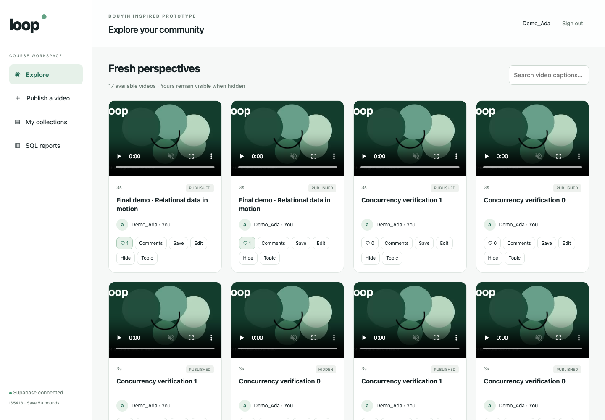

# Loop · IS5413 抖音短视频数据库项目

面向 IS5413 Database Management 小组作业的可运行原型：**10 个实体、43 个字段、PostgreSQL 17、10 项 SQL 报表**。

## 查看作业

- [在线阅读最终报告](Final_Report_Douyin.md)
- [下载 Word 报告（公开脱敏版，16 页）](交付物/IS5413_Final_Report_Douyin.docx)
- [5 分钟演示稿与答辩要点](DEMO_5min.md)
- [数据字典](数据字典_PostgreSQL.md)
- [PostgreSQL SQL 文件](sql/postgresql)
- [运行与复现说明](prototype/README.md)

公开版已隐去组员姓名、学号和所有登录凭据。正式提交版由小组在本机保存。



## 已实现

- 视频发布、搜索、文案编辑、话题、隐藏与恢复。
- 点赞、关注、评论和同视频回复。
- 私人收藏夹及并发安全的夹内编号。
- 真实数据库账号身份校验、所有权限制、隐藏视频互动限制。
- 10 项只读 SQL 报表、移动端界面、原创演示视频。

验证记录包含 **31 项结构检查、21 项业务与并发测试、4 项不可变性探测、14 项浏览器检查**。数据为虚构教学数据；完整重建曾在隔离 schema 的回滚事务中验证。

## 运行

需要 Python 3.10+ 和自己的 Supabase 项目。网页由本地 Python 服务运行，GitHub 仓库本身不是在线部署的网站。

```sh
cd prototype
python3 -m venv .venv
.venv/bin/python -m pip install -r requirements.txt
.venv/bin/python setup_demo.py --host '<从你的 Supabase 项目复制的数据库主机>'
.venv/bin/python app.py
```

打开 http://127.0.0.1:5413 。初始化脚本交互式读取管理员密码，生成受限演示账号，并拒绝覆盖已有 schema。详细步骤见 [prototype/README.md](prototype/README.md)。

**不要向本仓库提交 `.local/`、数据库密码、连接凭据或虚拟环境。** 学校课程平台的最终提交由组长负责。
